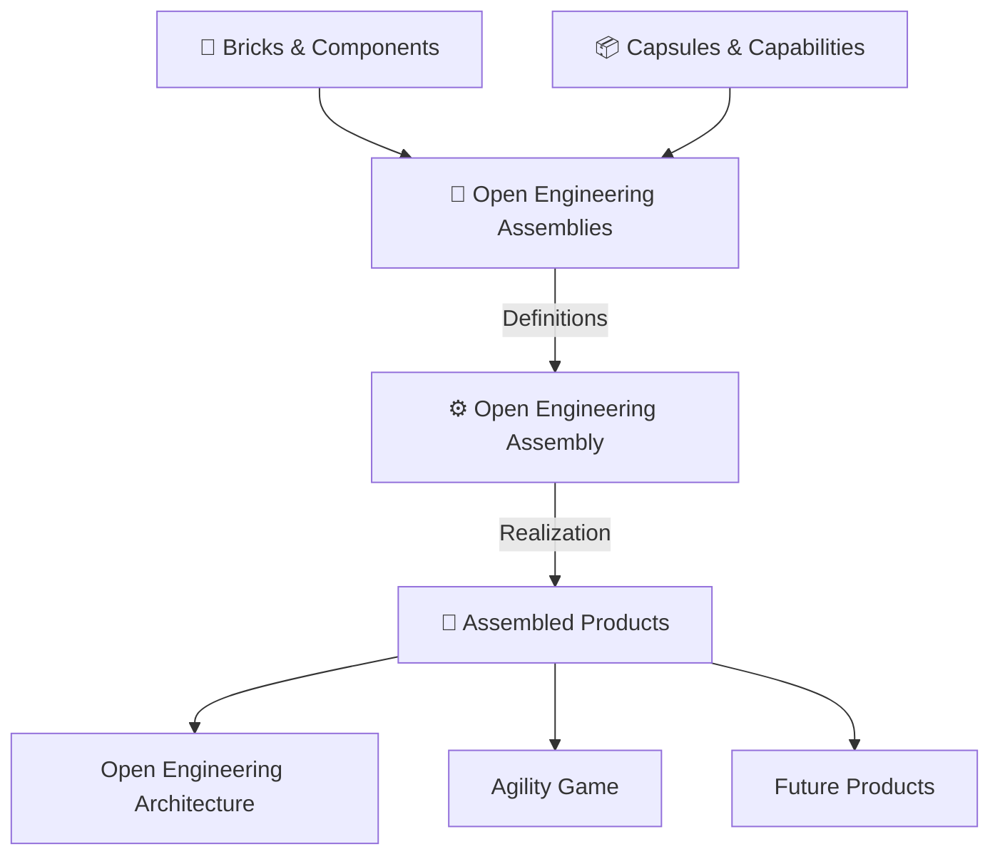
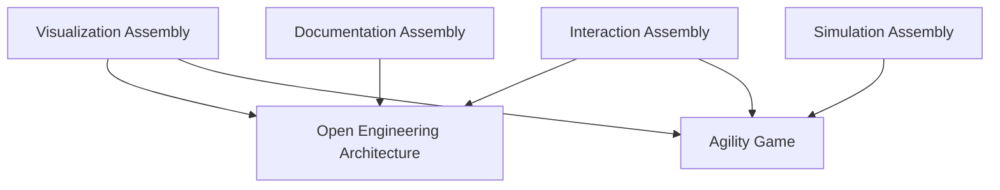
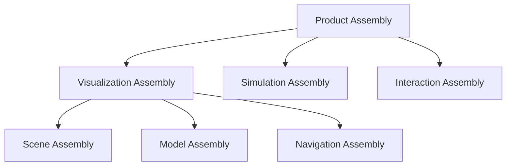

# Open Engineering Assemblies

> **Define once. Assemble repeatedly. Reuse everywhere.**

Welcome to **Open Engineering Assemblies**, the organization responsible for defining reusable, interoperable, and composable engineering assemblies within the Open Engineering Ecosystem.

Inspired by the LEGO building system, Open Engineering transforms the way engineering solutions are created: from building individual products to assembling products from standardized, reusable engineering elements.

**Open Engineering Assemblies defines what can be assembled. Open Engineering Assembly implements how it is assembled.**

---

## 🧱 From Building to Assembly

Traditional software engineering often builds applications as independent solutions, resulting in duplicated capabilities, tightly coupled components, and limited reuse.

Open Engineering adopts a different approach.

Just as LEGO bricks can be combined into subassemblies and complete models, Open Engineering components can be composed into reusable assemblies and delivered as products.



The result is an engineering ecosystem where reusable capabilities can be combined into increasingly sophisticated products without repeatedly implementing their underlying functionality.

---

## 🎯 Our Mission

**To establish a standardized assembly system for engineering solutions.**

Open Engineering Assemblies provides the definitions, interfaces, constraints, and composition contracts that allow independently developed engineering elements to work together.

Our objectives are to:

- **Standardize composition** through declarative assembly definitions.
- **Enable interoperability** through explicit, versioned interfaces.
- **Maximize reuse** across independently evolving products.
- **Support recursive composition** through reusable subassemblies.
- **Ensure compatibility** through automated validation.
- **Promote reproducibility** through versioned dependencies and immutable releases.
- **Accelerate product engineering** through assembly rather than duplication.

---

## 🧩 What Is an Assembly?

An **assembly** is a structured composition of engineering elements that collectively provide a capability or realize a product.

An assembly may contain:

- Bricks and components
- Capsules and capabilities
- Systems and services
- Models and digital twins
- Interfaces and connections
- Other assemblies

Assemblies are recursively composable.

For example:

```text
Visualization Assembly
│
├── Scene Assembly
│   ├── Scene Definition
│   └── Scene Configuration
│
├── Model Assembly
│   ├── GLB Models
│   └── Model Registry
│
├── Navigation Assembly
│   ├── Camera Controls
│   └── Navigation Behaviors
│
└── Interaction Assembly
    ├── Selection
    └── Events
```

The Visualization Assembly can subsequently be reused by multiple products.

---

## 🏗️ Assemblies vs. Assembly

Open Engineering separates assembly definitions from their implementation.

| | Open Engineering Assemblies | Open Engineering Assembly |
|---|---|---|
| **Purpose** | Define compositions | Realize compositions |
| **Primary concern** | What constitutes an assembly? | How is an assembly produced? |
| **Responsibilities** | Definitions, interfaces, constraints, dependencies | Resolution, validation, planning, execution |
| **Artifacts** | YAML, JSON Schema, contracts | Assembly plans, manifests, product artifacts |
| **Role** | Specification | Implementation |

### Open Engineering Assemblies

This organization defines the reusable building instructions of the ecosystem.

It establishes:

- Assembly definitions
- Assembly interfaces
- Component relationships
- Compatibility contracts
- Configuration parameters
- Dependency constraints
- Composition patterns
- Assembly specifications

### Open Engineering Assembly

[Open Engineering Assembly](https://github.com/open-engineering-assembly) is responsible for interpreting these definitions and realizing assemblies.

Its proposed responsibilities include:

1. Loading assembly definitions.
2. Resolving component dependencies.
3. Validating interfaces and constraints.
4. Applying assembly configurations.
5. Creating executable assembly plans.
6. Coordinating specialized engineering engines.
7. Producing and publishing assembly artifacts.

This separation enables assembly definitions to evolve independently from the technology used to implement them.

---

## 📐 Assembly Definitions as Code

Assemblies are described using declarative, machine-readable definitions.

YAML is the proposed initial format, supported by JSON Schema validation.

### Example: Visualization Assembly

```yaml
apiVersion: openengineering.dev/v1alpha1
kind: AssemblyDefinition

metadata:
  name: visualization
  version: 1.0.0
  description: >
    Reusable visualization assembly for
    interactive engineering products.

spec:
  components:
    - name: scene
      type: capsule
      reference: open-engineering-scene
      version: "1.x"

    - name: models
      type: capsule
      reference: open-engineering-model
      version: "1.x"

    - name: navigation
      type: capsule
      reference: open-engineering-navigation
      version: "1.x"

  interfaces:
    provides:
      - name: visualization-api
        contract: visualization-api-v1

  configuration:
    parameters:
      - name: renderer
        type: string
        default: babylonjs

  constraints:
    validateInterfaces: true
    detectCycles: true

  outputs:
    - name: visualization-bundle
      type: artifact
```

*This example illustrates the proposed assembly contract. The schema and referenced components are not yet guaranteed to be implemented.*

The definition describes what the assembly consists of without prescribing the internal implementation of each component.

---

## 🚀 Products Are Assembled

Open Engineering Architecture and Agility Game are reference products for the assembly-first approach.

### Open Engineering Architecture

[Open Engineering Architecture](https://github.com/open-engineering-architecture) enables modeling, visualization, documentation, assessment, and exploration of engineering systems.

Its proposed composition includes:

```text
Open Engineering Architecture
│
├── Modeling Assembly
├── Visualization Assembly
├── Documentation Assembly
├── Assessment Assembly
├── Scenario Assembly
└── Mission Assembly
```

### Agility Game

[Agility Game](https://github.com/orgs/agility-game/repositories) is an interactive business simulation inspired by board-game mechanics.

Its proposed composition includes:

```text
Agility Game
│
├── Visualization Assembly
├── Simulation Assembly
├── Interaction Assembly
├── Identity Assembly
└── Game Rules Capsule
```

### Shared Capabilities

Both products can consume the same reusable assembly definitions.



This demonstrates the fundamental objective:

**Develop capabilities once and reuse them across multiple products.**

---

## 🔌 Interfaces and Compatibility

The LEGO system succeeds because its elements share standardized connection mechanisms.

Open Engineering applies the same principle to software and engineering capabilities.

Components must declare the interfaces they provide and require.

An assembly definition specifies how those interfaces connect.

Compatibility validation can include:

- Interface identity and version
- Input and output schemas
- Required capabilities
- Supported protocols
- Configuration constraints
- Dependency compatibility
- Security policies

> **Components may be assembled only when their declared interfaces and constraints permit composition.**

This principle supports interoperability without requiring every component to share the same internal implementation.

---

## ♻️ Recursive Composition

An assembly may contain another assembly.

This enables complex products to emerge from smaller reusable compositions.



Assembly dependencies must form a directed acyclic graph.

This allows recursive composition while preventing circular dependency resolution.

Each subassembly can be independently versioned, validated, tested, and released.

---

## 🧬 Assembly Ontology

Open Engineering Assemblies extends the Open Engineering ontology with concepts specifically supporting composition.

| Entity | Responsibility |
|---|---|
| `AssemblyDefinition` | Describes an assembly's structure |
| `AssemblyInstance` | Represents a realized assembly |
| `AssemblyInterface` | Defines a provided or required interface |
| `AssemblyConnection` | Connects compatible interfaces |
| `AssemblyConstraint` | Governs valid composition |
| `AssemblyConfiguration` | Supplies instance-specific parameters |
| `AssemblyArtifact` | Represents a generated deliverable |
| `AssemblyRelease` | Publishes a versioned assembly |

Key relationships include:

```text
Product
    IS_REALIZED_BY
AssemblyInstance

AssemblyInstance
    CONFORMS_TO
AssemblyDefinition

AssemblyDefinition
    CONTAINS
Component

AssemblyDefinition
    REFERENCES
AssemblyDefinition

Component
    EXPOSES
AssemblyInterface

AssemblyConnection
    CONNECTS
AssemblyInterface
```

These concepts complement existing Open Engineering entities such as Character, Mission, Scene, System, Capability, Product, and Release.

---

## 📦 Assembly Lifecycle

An assembly progresses through a defined lifecycle.


The lifecycle supports:

- Automated schema validation
- Dependency resolution
- Compatibility verification
- Reproducible composition
- Artifact generation
- Release management
- Provenance tracking

Published releases should reference immutable component versions and artifact digests.

---

## 🗂️ Repository Organization

The proposed repository structure separates specifications, schemas, reusable definitions, and examples.

```text
open-engineering-assemblies/
│
├── README.md
│
├── specification/
│   ├── assembly-definition.md
│   ├── assembly-interface.md
│   └── assembly-constraint.md
│
├── schema/
│   ├── assembly-definition.schema.json
│   └── assembly-interface.schema.json
│
├── assemblies/
│   ├── visualization/
│   ├── interaction/
│   ├── simulation/
│   └── documentation/
│
├── examples/
│   ├── architecture/
│   └── agility-game/
│
├── decision/
├── assessment/
├── memo/
│
└── .github/
    └── workflows/
        ├── validate.yaml
        └── release.yaml
```

This is a proposed structure to be reconciled with the existing repositories.

---

## 🌐 Open Engineering Ecosystem

Open Engineering Assemblies collaborates with specialized organizations throughout the ecosystem.

| Organization | Contribution |
|---|---|
| [Open Engineering Brick](https://github.com/open-engineering-brick) | Fundamental reusable engineering elements |
| [Open Engineering Bricks](https://github.com/open-engineering-bricks) | Collections of reusable bricks |
| [Open Engineering Model](https://github.com/open-engineering-model) | Model generation and GLB artifacts |
| [Open Engineering Rig](https://github.com/open-engineering-rig) | Rigging and articulated models |
| [Open Engineering Architecture](https://github.com/open-engineering-architecture) | Assembled architecture product |
| [Open Engineering Assembly](https://github.com/open-engineering-assembly) | Assembly implementation |
| [Agility Game](https://github.com/orgs/agility-game/repositories) | Assembled interactive simulation product |

The ecosystem favors reusable capabilities and explicit interfaces over product-specific duplication.

---

## 🛠️ Technology Foundations

Open Engineering Assemblies builds upon established technologies and standards.

| Technology | Purpose |
|---|---|
| YAML | Declarative assembly definitions |
| JSON Schema | Structural validation |
| Semantic Versioning | Version compatibility |
| GitHub Actions | Automated validation and releases |
| GitHub Releases | Artifact publication |
| OCI | Content-addressable artifact distribution |
| LDraw | LEGO-compatible model definitions |
| glTF / GLB | Portable 3D models |
| LikeC4 | Architecture modeling |
| Babylon.js | Interactive 3D visualization |
| CycloneDX | Component and dependency transparency |
| SLSA | Software supply-chain provenance |

Technology choices should remain replaceable through explicit contracts wherever practical.

---

## 🧭 Roadmap

### Phase 1 — Define

- [ ] Establish the assembly ontology.
- [ ] Specify `AssemblyDefinition`.
- [ ] Specify `AssemblyInterface`.
- [ ] Specify `AssemblyConstraint`.
- [ ] Publish JSON Schemas.

### Phase 2 — Validate

- [ ] Implement schema validation.
- [ ] Introduce dependency resolution.
- [ ] Detect circular dependencies.
- [ ] Validate interface compatibility.

### Phase 3 — Assemble

- [ ] Implement the Assembly engine MVP.
- [ ] Define the Visualization Assembly.
- [ ] Integrate existing Model artifacts.
- [ ] Generate assembly manifests.

### Phase 4 — Reuse

- [ ] Introduce an Architecture product definition.
- [ ] Introduce an Agility Game product definition.
- [ ] Demonstrate shared Visualization Assembly reuse.
- [ ] Publish versioned assembly artifacts.

### Phase 5 — Expand

- [ ] Introduce additional reusable assemblies.
- [ ] Support assembly discovery.
- [ ] Extend assembly visualization.
- [ ] Support additional products.

---

## 📚 References

The following standards and technologies inform the proposed architecture.

- [LDraw — File Format Specification](https://www.ldraw.org/article/218.html)
- [LDraw — Multi-Part Documents](https://www.ldraw.org/article/47.html)
- [JSON Schema](https://json-schema.org/specification)
- [Semantic Versioning](https://semver.org/)
- [Open Container Initiative](https://opencontainers.org/)
- [GitHub Actions](https://docs.github.com/en/actions)
- [GitHub Releases](https://docs.github.com/en/repositories/releasing-projects-on-github/about-releases)
- [OpenAPI Specification](https://spec.openapis.org/oas/latest.html)
- [AsyncAPI](https://www.asyncapi.com/)
- [CycloneDX](https://cyclonedx.org/)
- [SLSA](https://slsa.dev/)
- [LikeC4](https://likec4.dev/)
- [Babylon.js](https://www.babylonjs.com/)

---

## 🤝 Contributing

Contributions are welcome in areas such as:

- Assembly specifications
- Interface contracts
- Reusable assembly definitions
- Composition patterns
- Validation schemas
- Reference implementations
- Documentation
- Compatibility testing

Before introducing a new assembly, consider whether an existing assembly or capability can be reused or extended.

Favor small, cohesive, interoperable compositions over tightly coupled, product-specific implementations.

---

## 💡 Our Philosophy

The LEGO system demonstrates that sophisticated creations do not require every element to be invented from scratch.

They require reusable elements, standardized connections, and clear assembly instructions.

Open Engineering applies this philosophy to engineering solutions.

**Bricks provide the elements.**

**Capsules provide the capabilities.**

**Assemblies define the compositions.**

**Assembly realizes the compositions.**

**Products deliver the outcomes.**

---

### Define once. Assemble repeatedly. Reuse everywhere.

**Open Engineering Assemblies**

*From building individual solutions to assembling an engineering ecosystem.*
